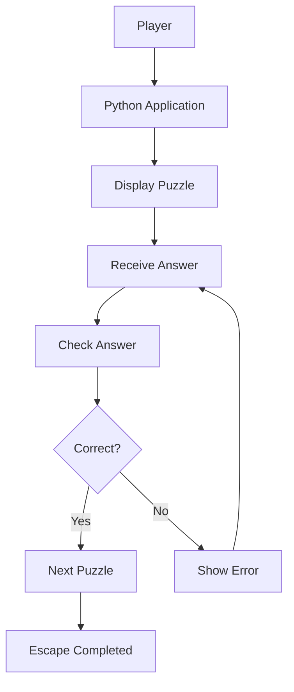
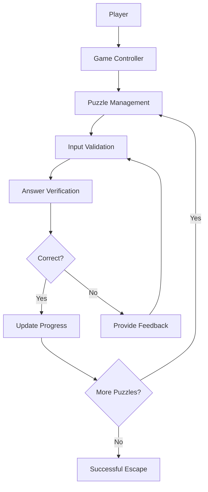

# AI ESCAPE ROOM
## Project Development and Technical Report

**Course:** MSc Data Science  
**University:** University of Europe for Applied Sciences  
**Student Name:** Kalyan Venkat Godugu  
**Project Title:** AI Escape Room  
**Programming Language:** Python  
**Submission Date:** 15 November 2026

---

# 1. Introduction

The AI Escape Room is a Python-based interactive application designed to provide users with a virtual escape room experience. Players solve puzzles, answer questions and complete challenges to progress through the game.

The main purpose of this project is to demonstrate Python programming skills, logical problem-solving, application development and iterative software improvement.

The assignment requires two versions of the application. Version 1 represents the initial implementation, while Version 2 focuses on improving the application's functionality, reliability and user experience.

# 2. Project Objectives

The main objectives are:

1. Develop an interactive Escape Room application using Python.
2. Implement puzzles and challenges that require logical thinking.
3. Accept and validate user answers.
4. Develop two identifiable application versions.
5. Identify limitations in the initial implementation.
6. Improve the application in Version 2.
7. Test the application using different scenarios.
8. Document the development process using GitHub.

# 3. Technologies Used

| Technology | Purpose |
|---|---|
| Python | Main programming language |
| Visual Studio Code | Code development |
| Git | Version control |
| GitHub | Project hosting and portfolio |
| Python libraries | Application functionality |

# 4. Project Architecture

The application follows a simple modular workflow in which the player interacts with the Python application, receives puzzles, enters answers and receives feedback.

## 4.1 Version 1 Architecture

The initial architecture consists of the following components:

- Player interaction
- Puzzle presentation
- User input
- Answer checking
- Game progression
- Final escape result

Architecture diagram:

## 4.2 Version 2 Architecture

The improved architecture is intended to introduce better separation of responsibilities and more reliable input handling.

Main components:

- Game controller
- Puzzle management
- Input validation
- Answer verification
- Progress tracking
- Feedback management

Architecture diagram:

# 5. Version 1 – Initial Implementation

Version 1 is the first development stage of the application.

The objective is to establish the basic Escape Room gameplay and create a working application.

Expected functionality:

- Display an introduction to the game.
- Present puzzles to the player.
- Accept answers through user input.
- Check answers against expected solutions.
- Display feedback for correct and incorrect answers.
- Allow the player to progress through the game.

The initial version provides the foundation for further development.

# 6. Version 2 – Improved Implementation

Version 2 builds upon the initial application.

The main objective is to address limitations identified during Version 1 testing.

Planned improvement areas:

- Improved input validation.
- Better handling of incorrect answers.
- Improved error handling.
- Clearer game instructions.
- Improved code organisation.
- More reliable game progression.
- Better user feedback.

These improvements aim to make the application more robust and user-friendly.

# 7. Comparison Between Version 1 and Version 2

| Feature | Version 1 | Version 2 |
|---|---|---|
| Basic gameplay | Initial implementation | Improved |
| Puzzle handling | Basic | Enhanced |
| Input validation | Basic | Improved |
| Error handling | Initial | Enhanced |
| User feedback | Basic | Improved |
| Code organisation | Initial structure | Refined structure |

The final comparison should be updated after both versions have been implemented and tested.

# 8. Testing and Evaluation

Testing is necessary to verify that the application behaves correctly under different conditions.

The following five test cases will be used:

| Test ID | Test Scenario | Expected Result |
|---|---|---|
| TC01 | Enter the correct answer | Application accepts the answer |
| TC02 | Enter an incorrect answer | Application displays feedback |
| TC03 | Submit empty input | Application handles empty input |
| TC04 | Enter unexpected characters | Application handles invalid input without crashing |
| TC05 | Complete all puzzles | Application displays the escape success message |

Actual results and pass/fail status must be recorded after running the programs.

# 9. Security and Configuration

The project uses configuration files to separate application settings from source code.

The following files are included:

- `.env` – Stores private configuration values.
- `.env.example` – Provides an example configuration.
- `.gitignore` – Prevents private and unnecessary files from being uploaded.
- `requirements.txt` – Lists the Python dependencies.

API keys and passwords must not be committed to the public GitHub repository.

If an external AI API is not integrated, the application should not claim to use a live AI service.

# 10. GitHub Repository and Development Process

GitHub is used to maintain the project source code and document its development.

Repository name: `AI-Escape-Room`

The repository will contain:

- Version 1 source code.
- Version 2 source code.
- Requirements file.
- Environment configuration template.
- README documentation.
- Application screenshots.
- Project report.

Meaningful Git commits will be used to demonstrate the development process.

# 11. Limitations

Potential limitations of the initial application include:

- Limited puzzle variety.
- Dependence on predefined answers.
- Limited flexibility in accepting user responses.
- Basic interaction compared with a graphical application.
- No dynamic puzzle generation unless an AI integration is implemented.

These limitations will be evaluated during development and testing.

# 12. Future Enhancements

Possible future improvements include:

1. Integration with Large Language Models.
2. AI-generated puzzles and hints.
3. Multiple difficulty levels.
4. Graphical user interface.
5. Player scores and progress tracking.
6. Dynamic puzzle generation.
7. Improved interaction and feedback.

# 13. Conclusion

The AI Escape Room project provides an opportunity to apply Python programming and software development concepts to an interactive application.

The development of two versions demonstrates an iterative approach to application design. Version 1 establishes the initial functionality, while Version 2 focuses on addressing limitations and improving the overall application.

The project also demonstrates the importance of testing, documentation, version control and responsible handling of configuration information.

Through this assignment, practical experience is gained in Python application development and GitHub-based project management.

# 14. References

- Python Documentation: https://docs.python.org/3/
- Git Documentation: https://git-scm.com/doc
- GitHub Documentation: https://docs.github.com/
- University of Europe for Applied Sciences – Course assignment instructions.
