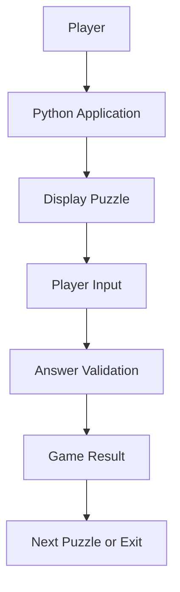
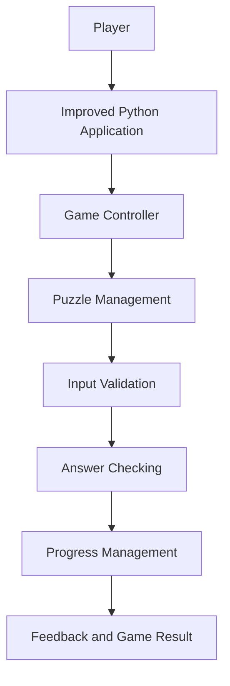

# 🔐 AI Escape Room

A Python-based AI Escape Room application developed as part of my MSc Data Science coursework at the University of Europe for Applied Sciences.

The project demonstrates the development of an interactive escape room application through two versions (Version 1 and Version 2), focusing on problem-solving, Python programming, application design and iterative improvement.

## 📌 Project Overview

The AI Escape Room challenges players to solve puzzles, answer questions and complete tasks to escape from a virtual room.

The project includes two development stages:

- **Version 1:** Initial implementation of the Escape Room application.
- **Version 2:** Improved implementation with additional functionality, better validation and enhanced user experience.

## 🎯 Project Objectives

- Develop an interactive Escape Room application using Python.
- Implement puzzles and problem-solving challenges.
- Demonstrate improvements between Version 1 and Version 2.
- Apply programming concepts and logical thinking.
- Test application functionality using different test scenarios.
- Maintain project documentation using GitHub.

## 🛠️ Technologies Used

- Python
- Git
- GitHub
- Visual Studio Code
- Python libraries (see `requirements.txt`)

## 📂 Project Structure

```text
AI-Escape-Room/
│
├── version1.py
├── version2.py
├── requirements.txt
├── .env.example
├── .gitignore
├── README.md
│
└── screenshots/
    ├── version1.png
    └── version2.png
```

## 🚀 Installation and Setup

### 1. Clone the repository

```bash
git clone https://github.com/YOUR_USERNAME/AI-Escape-Room.git
```

### 2. Navigate to the project folder

```bash
cd AI-Escape-Room
```

### 3. Create a virtual environment

```bash
py -m venv .venv
```

### 4. Activate the virtual environment

Windows PowerShell:

```powershell
.venv\Scripts\Activate.ps1
```

### 5. Install dependencies

```bash
pip install -r requirements.txt
```

### 6. Run Version 1

```bash
python version1.py
```

### 7. Run Version 2

```bash
python version2.py
```

## 🧩 Version 1 – Initial Implementation

Version 1 represents the first implementation of the Escape Room application.

It establishes the basic application structure and initial gameplay functionality.

**Main focus:**
- Basic game flow.
- Initial puzzle implementation.
- User input and answer checking.
- Basic escape room experience.

## 🚀 Version 2 – Improved Implementation

Version 2 builds upon the initial implementation and introduces improvements.

**Improvement areas:**
- Improved application structure.
- Better input validation.
- Enhanced error handling.
- Improved puzzle-solving experience.
- More reliable game flow.
- Additional functionality where applicable.

The purpose of Version 2 is to address limitations identified during Version 1 testing.

## 🏗️ System Architecture

### Version 1 Architecture



### Version 2 Architecture



## 🧪 Testing

The application will be evaluated using the following test scenarios:

| Test Case | Scenario | Expected Result |
|---|---|---|
| TC01 | Correct puzzle answer | Accept answer |
| TC02 | Incorrect puzzle answer | Display error message |
| TC03 | Empty user input | Handle invalid input |
| TC04 | Invalid input format | Prevent application crash |
| TC05 | Complete all puzzles | Display successful escape message |

Actual results will be recorded after testing both versions.

## 📸 Screenshots and Demonstration

Screenshots of the application will be added here to demonstrate the gameplay and improvements.

- Version 1 screenshots
- Version 2 screenshots
- Application execution

## 🔒 Environment Variables and Security

Sensitive information such as API keys and credentials must never be uploaded to GitHub.

- `.env` stores private configuration.
- `.env.example` provides a configuration template.
- `.gitignore` prevents sensitive and unnecessary files from being committed.

## 📈 Development Process

The project follows an iterative development approach:

1. Create the initial application.
2. Implement basic game functionality.
3. Test Version 1.
4. Identify limitations and errors.
5. Develop Version 2 improvements.
6. Test the improved application.
7. Document the architecture and results.
8. Upload the project to GitHub.

## 🔮 Future Improvements

- Integration with Large Language Models (LLMs).
- Dynamically generated puzzles.
- Intelligent hints and feedback.
- Multiple difficulty levels.
- Improved graphical user interface.
- Player progress tracking.

## 👨‍💻 Author

**Kalyan Venkat Godugu**

MSc Data Science  
University of Europe for Applied Sciences

## 📚 Academic Project

Developed as part of the AI Escape Room and GitHub Portfolio assignment.

**Project:** AI Escape Room  
**Programming Language:** Python  
**Repository:** AI-Escape-Room

---

⭐ Thank you for visiting my project repository!
